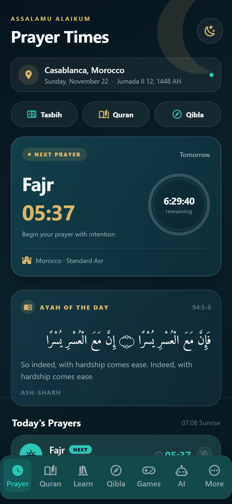
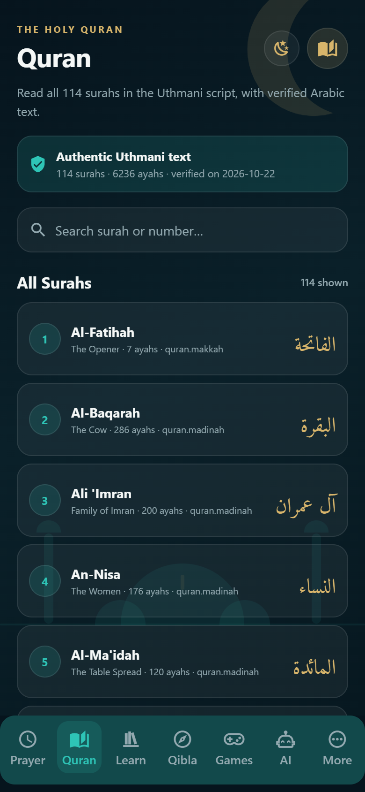
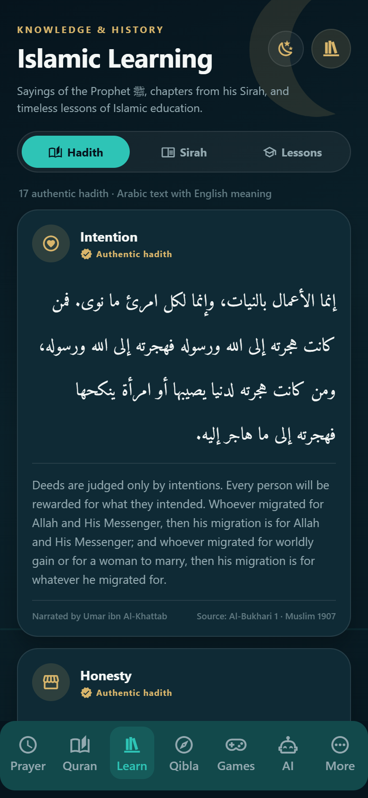
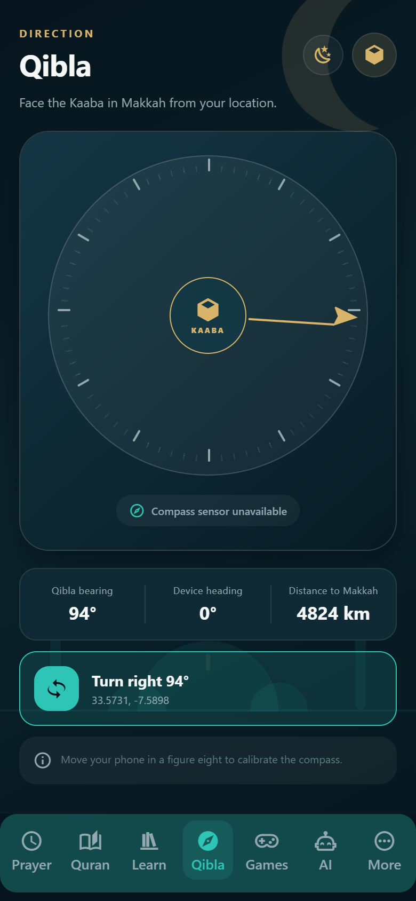
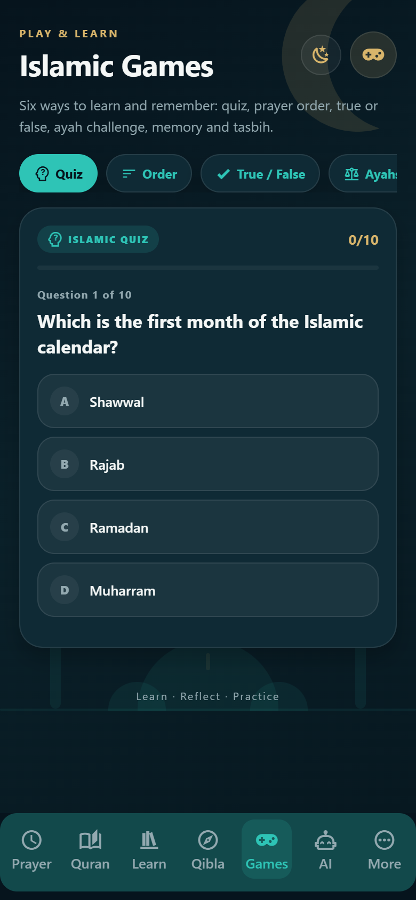
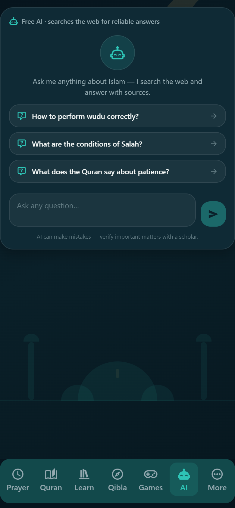
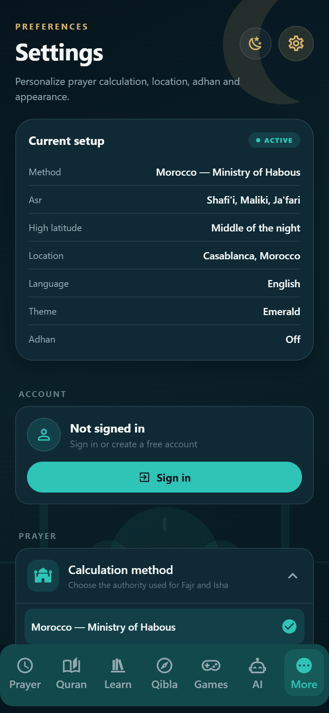

<p align="center">
  
</p>

<h1 align="center">Slati Pro
p/ From the developer ELASSAL ALAE </h1>

<p align="center">
  <strong>تطبيق إسلامي عصري — أوقات الصلاة، القرآن، القبلة، التعلّم، الألعاب ومساعد ذكي</strong><br />
  <em>A modern Islamic companion for Android & Windows — prayer times, Quran, Qibla, learning, games and a free AI assistant.</em>
</p>

<p align="center">
  
  
  
  
</p>

## 🎬 Vidéos / فيديوهات

**فيديو النشر — حماسي بموسيقى (30 ثانية / MP4):**

<p align="center">
  <video src="docs/slati-pro-publication.mp4" controls width="360"></video><br />
  <a href="docs/slati-pro-publication.mp4">▶ تحميل فيديو النشر / Download the publication video</a>
</p>

**فيديو تعريفي هادئ — بلا موسيقى (24 ثانية / WebM):**

<p align="center">
  <video src="docs/slati-pro-promo.webm" controls width="360"></video><br />
  <a href="docs/slati-pro-promo.webm">▶ تحميل الفيديو التعريفي / Download the promo video</a>
</p>

---

## 📱 شنو كاين فالتطبيق / What's inside

| Feature | الوصف | Details |
|---|---|---|
| 🕌 Prayer Times | أوقات دقيقة بحسب طريقة المغرب، مع الأذان والتنبيهات | Accurate times (Morocco method + others), adhan, notifications, per-prayer offsets |
| 📖 Quran | 114 سورة بالخط العثماني مع بحث وقراءة | Full Uthmani text, 114 surahs, search, ayah of the day |
| 🧭 Qibla | بوصلة اتجاه القبلة | Compass powered by device sensors |
| 📚 Learn | دروس، سيرة، أحاديث وأدعية | Lessons, sirah, hadith and supplications |
| 🎮 Games | 6 ألعاب: اختبار، ترتيب، صح/خطأ، تحدي الآيات، ذاكرة وتسبيح | Quiz, prayer order, true/false, ayah challenge, memory, tasbih |
| 🤖 AI | مساعد مجاني بلا مفتاح API، كيجاوب بالدارجة | Free, keyless assistant that replies in Moroccan Darija |
| 🎨 Themes | زمردي، ذهبي وفاتح + تبديل سريع | Emerald, gold and light themes + quick theme toggle |
| ♿ Accessibility | تكبير الخط، دعم قارئ الشاشة، تقليل الحركة | Font scaling, screen-reader labels, reduced motion |

> التطبيق كيحافظ على أسلوب **Glassmorphism** (زجاجي شفاف، حواف مستديرة، ألوان ديناميكية) فكل الشاشات.
> The Glassmorphism style (translucent surfaces, rounded corners, dynamic colors) is used across all screens.

---

## 📸 Screenshots

| Prayer Times | Quran | Learn |
|:---:|:---:|:---:|
|  |  |  |

| Qibla | Games | AI |
|:---:|:---:|:---:|
|  |  |  |

| Settings |
|:---:|
|  |

---

## ⬇️ التثبيت / Installation

### Android
1. افتح صفحة [Releases](../../releases/latest).
2. حمّل `Slati Pro.apk` (أو `Slati Pro.apk.zip` وفكّو).
3. ثبّتو على الجهاز — الإصدار موجّه لـ **arm64-v8a** (أغلب الهواتف الحديثة).
4. إذا منعك Android التثبيت: السماح بتثبيت التطبيقات من مصادر غير معروفة للمتصفح/مدير الملفات.

### Windows
1. حمّل `Slati Pro.exe` من [Releases](../../releases/latest).
2. شغّلو مباشرة — نسخة **portable** ما كتحتاجش تثبيت (x64).
3. إذا منعه Windows SmartScreen: «More info» → «Run anyway» (الملف غير موقّع رقمياً).

---

## 🛠️ البناء من المصدر / Build from source

```bash
npm install
npx expo start            # development / Metro
npx expo start --web      # web preview
```

**Android (arm64 release APK):**
```bat
C:\s\build-modern-arm64.bat
```
Output: `C:\b\s\outputs\apk\release\app-release.apk`

**Windows (portable exe):**
```bat
cd desktop
npm install
npm run dist
```
Output: `desktop\release\Slati Pro.exe`

> ملاحظة: `Slati Pro Lite` (الحزمة `app.slati.lite`, armeabi-v7a) مشروع منفصل وما كاينش فالـ releases ديال Pro.

---

## 🔐 الخصوصية / Privacy

- الحسابات **محلية تماماً** (AsyncStorage) — ما كاينة أي خدمة سيرفر، لا مفاتيح ولا تسجيل عن بُعد.
- Google / Facebook ما زالو «جاهزين» بانتظار إدخال client IDs حقيقية فـ `src/auth/socialConfig.js`.
- المساعد الذكي مجاني بلا مفتاح API، كيستعمل بحثاً على الويب + Pollinations، والرد كيكون بالدارجة. كيحتاج إنترنت، وقد يخطئ — راجع الأمور المهمة مع عالم.
- الأذان والصور مستخدمين من مصادر حرة (انظر `assets/sounds/ATTRIBUTION.txt` و `assets/fonts/OFL.txt`).

---

## 📁 الهيكل / Project structure

```
App.js                     navigation, glass tab bar, theme provider
src/screens/               Prayer Times, Quran, Qibla, Learn, Games, AI, Settings, Auth
src/components/            themed UI components
src/data/                  Quran, cities, lessons, hadith, sirah
src/ai.js                  free AI + web context (Darija)
src/auth/                  local accounts (no server)
src/theme.js               emerald / gold / light palettes
desktop/                   Electron wrapper + web export
release/                   built APK / EXE (not committed to git)
```

---

<p align="center">صُنع بـ ♥ · Made with ♥ for the Moroccan Muslim community.</p>
